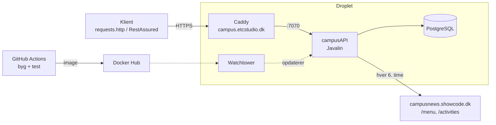
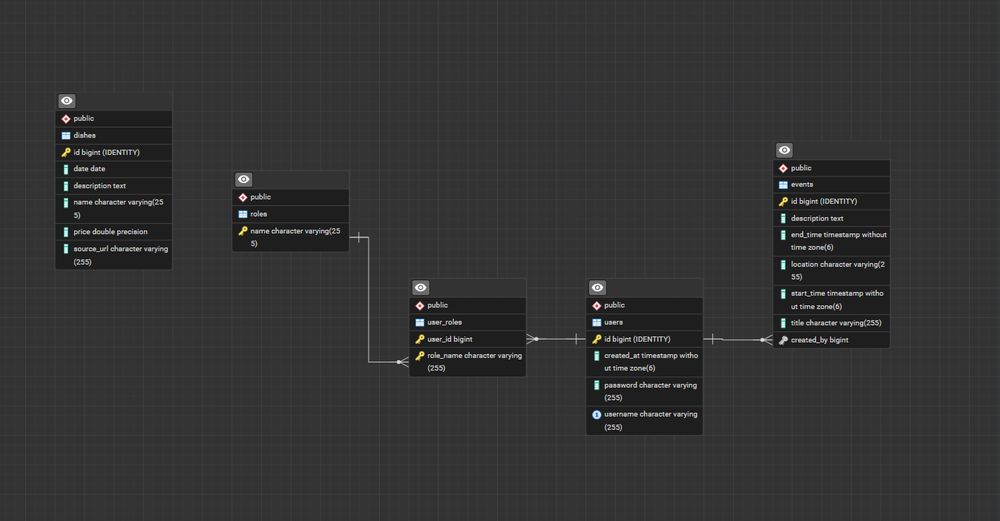

# Campus Bornholm API

Et REST API, der samler dagens ret og kommende events for studerende på Campus Bornholm ét sted.
Campus' eget site (cafs.dk) har ingen API, så data hentes automatisk fra et scrapet JSON-API og gøres tilgængeligt med login og roller.

## Links

- **Deployet API:** https://campus.etcstudio.dk/api (alle endpoints: https://campus.etcstudio.dk/api/routes)
- **Source code:** https://github.com/Grottenhofnar/campus-bornholm
- **Portfolio:** _link indsættes_

## Architecture

### System Overview

Backend-only REST API i Java 17, bygget i lag:

| Lag | Pakke | Ansvar |
|---|---|---|
| Web | `config` (`ApplicationConfig`, `Routes`), `controllers`, `security` | Javalin 6: routing, validering, JSON, CORS, JWT og roller |
| Service | `services` | Henter menu og events fra campus-API'et med `HttpClient` + Jackson og importerer dem med tråde |
| Data | `daos`, `dtos`, `entities` | JPA/Hibernate 6.6 med HikariCP mod PostgreSQL 16.2. DAO'erne returnerer DTO'er |

Teknologier: Javalin 6 · Hibernate/JPA · PostgreSQL · Jackson · Lombok · TokenSecurity (JWT) + jBCrypt · JUnit 5, Hamcrest, RestAssured, Testcontainers · Docker, GitHub Actions, Caddy, Watchtower.

### Architecture Diagram



### Key Design Decisions

- **Lag og DTO'er:** Controllers kender kun DTO'er (records). DAO'erne laver entitet → DTO, mens `EntityManager` er åben, så der hverken opstår `LazyInitializationException`, cirkulære referencer eller lækkede passwords.
- **Eksternt API gemmes lokalt:** `CampusImportService` henter menu og aktiviteter ved opstart og hver 6. time (`ScheduledExecutorService`). De to kald køres samtidig (`ExecutorService` + `CompletableFuture`). API'et virker derfor, selvom campus-API'et er nede.
- **Import uden dubletter:** Retter erstattes pr. dato. Importerede events har ingen opretter og erstattes samlet, så events oprettet af admin aldrig røres.
- **Security:** JWT (HS256) via `TokenSecurity`, passwords hashes med BCrypt. `authenticate` og `authorize` kører som `beforeMatched`-filtre, og hver route har en rolle (`ANYONE`, `USER`, `ADMIN`). Opretteren af et event kommer fra tokenet, ikke fra body.
- **Fejlhåndtering:** Én `ApiException` med statuskode. Globale handlers i `ApplicationConfig` giver altid samme JSON: `{ "status", "msg", "timestamp" }`. Valideringsfejl → 400, uventede fejl → 500 uden stacktrace til klienten.
- **Konfiguration:** `config.properties` lokalt, miljøvariabler på serveren (`CONNECTION_STR`, `DB_NAME`, `SECRET_KEY`, …). Hemmeligheder ligger aldrig i git.
- **Delvis opdatering = PATCH:** Kun felter, der sendes med, ændres.
- **Tidszone:** `AppClock` bruger `Europe/Copenhagen`, så "i dag" er rigtig, selvom serveren kører UTC.

## Data Model

### ERD

ERD genereret af pgAdmin ud fra databasen (`campus_bornholm`):



### Important Entities

| Entitet | Felter | Relationer |
|---|---|---|
| **User** (`users`) | id, username (unik), password (BCrypt), createdAt | `@ManyToMany` → Role via `user_roles` (EAGER) |
| **Role** (`roles`) | name (PK: `USER`, `ADMIN`) | `@ManyToMany(mappedBy = "roles")` |
| **Event** (`events`) | id, title, description, location, startTime, endTime | `@ManyToOne` → User (createdBy, valgfri) |
| **Dish** (`dishes`) | id, name, description, price, date, sourceUrl | Ingen – fyldes af importen |

## API Documentation

Base-URL: `https://campus.etcstudio.dk/api`. Beskyttede endpoints kræver `Authorization: Bearer <token>`.

| Method | URL | Request Body (JSON) | Response (JSON) | Rolle |
|---|---|---|---|---|
| GET | `/auth/healthcheck` | | `{"msg": "API is up and running"}` | ANYONE |
| POST | `/auth/register` | `{"username": String, "password": String}` | `201` token (e1) | ANYONE |
| POST | `/auth/login` | `{"username": String, "password": String}` | `200` token (e1) | ANYONE |
| GET | `/auth/me` | | `{"username": String, "roles": [String]}` | USER |
| GET | `/menu/today` | | `[dish]` (d1) | ANYONE |
| GET | `/menu/week` | | `{"weekNumber", "from", "to", "dishes": [dish]}` | ANYONE |
| GET | `/events?days=14` | | `[event]` (v1), de næste `days` dage (1–365) | ANYONE |
| GET | `/events/{id}` | | `event` (v1) | ANYONE |
| POST | `/events` | `{"title", "startTime", "description"?, "location"?, "endTime"?}` | `201` event (v1) | ADMIN |
| PATCH | `/events/{id}` | felterne fra POST, alle valgfrie | `200` event (v1) | ADMIN |
| DELETE | `/events/{id}` | | `204` | ADMIN |

```
(e1) Token: { "token": String, "username": String, "roles": [String] }
(v1) Event: { "id": Number, "title": String, "description": String, "location": String,
              "startTime": "2026-10-30T16:00:00", "endTime": "2026-10-30T22:00:00", "createdBy": String | null }
(d1) Dish:  { "id": Number, "name": String, "description": String, "price": Number,
              "date": "2026-10-26", "sourceUrl": String }
```

**Fejl** – samme format overalt: `{ "status": 404, "msg": "Event med id 99 findes ikke", "timestamp": "…" }`

| Status | Hvornår |
|---|---|
| 400 | Ugyldigt input, fx manglende titel, slut før start, ugyldig JSON |
| 401 | Intet/ugyldigt token, eller forkert brugernavn/password |
| 403 | Gyldigt token, men forkert rolle |
| 404 | Ukendt id eller route |
| 409 | Brugernavnet er optaget |

Alle requests kan prøves i `requests.http`.

## User Stories

| # | User story | Endpoint |
|---|---|---|
| US1 | Som gæst vil jeg kunne oprette en bruger, så jeg kan logge ind. | `POST /auth/register` |
| US2 | Som bruger vil jeg kunne logge ind, så jeg får adgang til det, der kræver login. | `POST /auth/login` |
| US3 | Som admin vil jeg have særlige rettigheder, så kun admins kan ændre indhold. | roller på routes |
| US4 | Som studerende vil jeg se dagens ret, så jeg ved om jeg skal have madpakke med. | `GET /menu/today` |
| US5 | Som studerende vil jeg se menuen for hele ugen, så jeg kan planlægge min uge. | `GET /menu/week` |
| US6 | Som admin vil jeg have at menu og events hentes automatisk fra campus, så ingen skal taste dem ind. | import med tråde |
| US7 | Som studerende vil jeg se hvad der sker de næste to uger, så jeg kan planlægge min tid. | `GET /events?days=14` |
| US8 | Som admin vil jeg oprette, rette og slette events, så oversigten er korrekt. | `POST/PATCH/DELETE /events` |

## Development Notes

### Kørsel lokalt

1. Start kursets Postgres-container: `docker start db`, og opret databasen én gang:
   `docker exec -it db psql -U postgres -c "CREATE DATABASE campus_bornholm;"`
2. Kopiér `config.properties.example` til `src/main/resources/config.properties` og udfyld værdierne.
3. Kør `Main` – serveren starter på http://localhost:7070/api, opretter admin-brugeren og importerer menu og events.
4. Tests: `mvn test` (Docker skal køre). Én testklasse af hver slags: `CampusApiServiceTest` (unit), `EventDAOTest` (DAO + Testcontainers) og `EventControllerTest` (RestAssured med login, 401 og 403).

### Deployment

Push til `master` → GitHub Actions bygger og tester → image til Docker Hub → Watchtower på dropletten henter det nye image → Caddy giver HTTPS. Filerne til serveren ligger i `deployment/` (`docker-compose.yml`, `Caddyfile`, `.env.example`).

### Udfordringer og læring

- **Postgres i Docker:** Password og databasenavn læses kun første gang datamappen oprettes. Det kostede en fejlsøgning med "password authentication failed", selvom `.env` var rigtig.
- **DNS:** En ny A-record kan tage op til 30 min., fordi DNS-servere husker "findes ikke". Kan testes uden om DNS med `curl --resolve`.
- **Brugere fra før hashing:** Brugere oprettet før BCrypt kunne ikke logge ind, fordi BCrypt ikke kan tjekke et password i klar tekst. Databasen måtte nulstilles.
- **Scope:** Projektet startede med nyheder og Wordle og blev skåret ned til det, kravene kræver. Mindre kode betød mere tid til tests og deployment.
- **Gemt data fra API:** Data gemmes lokalt og importeres hver 6. time i stedet for at blive hentet ved hvert request. Kommer der ingen data, beholdes de gamle.
